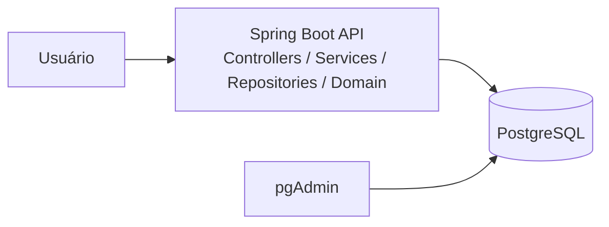

# Registro Arquitetural – B1 / Desafio 1

## RF
RF-RANK-01 – disponibilizar ranking considerando cursos concluídos e moedas.

## RNF / FURPS+
- Desempenho: o ranking é uma leitura candidata a receber carga superior às demais funcionalidades.
- Manutenibilidade: alterações de ranking devem ser localizáveis e testáveis.
- Operação: manter baixa complexidade operacional enquanto não houver evidência para distribuição.

## ASRs prioritários
1. Crescimento desigual de carga do Ranking.
2. Necessidade de manter o Core simples de operar.
3. Evolução frequente das regras de pontuação.

## RPCs
Java 17; Spring Boot; PostgreSQL; Docker; um único processo de deploy nesta alternativa.

## ADR-001 – Manter Monólito em Camadas como baseline
**Contexto:** o produto cresceu, mas ainda precisamos de evidência antes de introduzir distribuição.  
**Alternativas:** Monólito em Camadas; Monólito Modular; serviço independente de Ranking.  
**Decisão:** implementar o novo RF de Ranking mantendo a organização horizontal por camadas.  
**Consequências:** operação simples e baixo custo de mudança inicial; por outro lado, Ranking permanece no mesmo processo e escala junto com todo o Core.

## C4 – Container

## Evidência
`GET /api/ranking` e classes `RankingRestController`, `RankingService`, `RankingRepository` e `RankingResponseDTO`, distribuídas pelas camadas horizontais.
