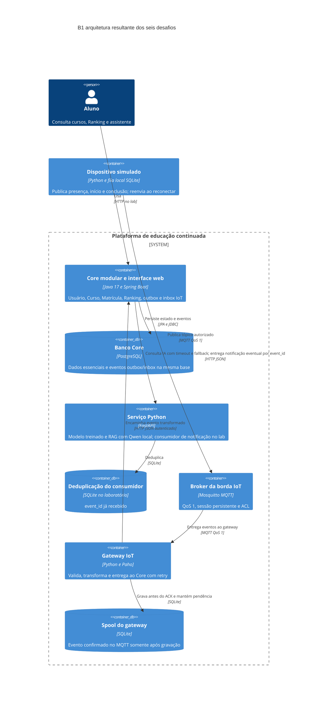
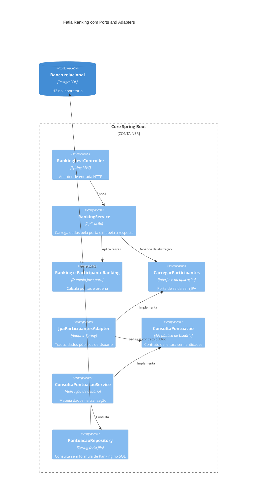
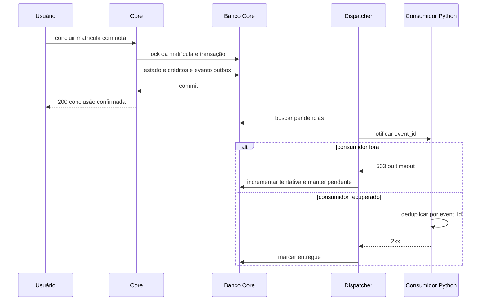
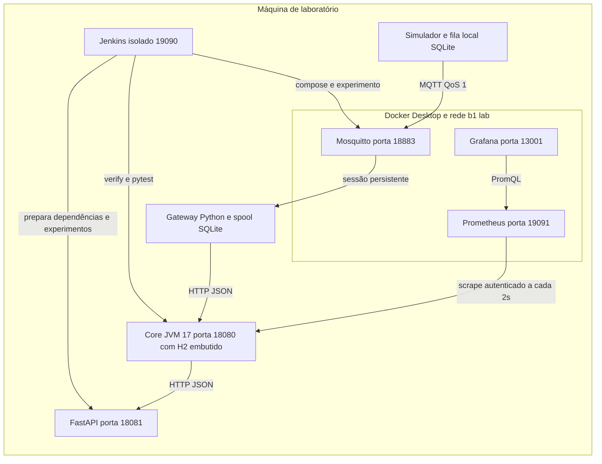

# Registro arquitetural vivo do B1

## Produto equipe e escopo

A plataforma de educação continuada evolui as bases fornecidas pela professora. O B1 reúne seis decisões rastreáveis, com até três ASRs por desafio. A entrega contém microsoluções que testam hipóteses arquiteturais; não é declaração de que um produto completo de IA e IoT está pronto para produção.

| Integrante | RA |
| --- | --- |
| Bruno Messias de Camargo | 235134 |
| Luis Alberto Sant'Anna de Araújo | 236401 |
| Brunno Eduardo Marfil Marins | 236051 |
| Bruno Romi Cervone | 235212 |

Equipe confirmada como a mesma do A2. O cenário didático do D1 considera seis desenvolvedores; a equipe real tem quatro integrantes. O prazo oficial do Canvas é 4 de novembro de 2026, 23h59, com 6 pontos possíveis. As bases B1 foram confirmadas no módulo oficial; mock_spring pertence ao material de mocks/A3. Ver [conferência do Canvas](../fontes-canvas/README.md).

## RFs e RNFs analisados

| Desafio | RF | RNFs considerados |
| --- | --- | --- |
| 1 | RF01 Ranking e RF02 conquistas e evolução da gamificação | Manutenibilidade, desempenho, escalabilidade, testabilidade e complexidade operacional |
| 2 | RF01 Ranking e RF02 regras de gamificação | Manutenibilidade, testabilidade, modificabilidade e facilidade de evolução |
| 3 | RF03 recomendação e RF04 assistente | Deploy independente, escalabilidade, tolerância a falhas, interoperabilidade, desempenho e manutenibilidade |
| 4 | RF02 conquistas e RF05 notificações | Tolerância a falhas, disponibilidade, latência, consistência, desacoplamento e recuperabilidade |
| 5 | RF06 eventos IoT | Interoperabilidade, eficiência de comunicação, disponibilidade, conectividade intermitente, escalabilidade e segurança |
| 6 | Todos os RFs afetados e operação | Observabilidade, deploy independente, confiabilidade, testabilidade, recuperabilidade e desempenho |

## Matriz cumulativa de ASRs

S = Supportability; P = Performance; R = Reliability; F = Functionality em FURPS+. A classificação ajuda a organizar a qualidade, sem transformar todo RNF em ASR. Cada frase de impacto explica uma mudança estrutural, de comunicação, dados ou operação.

| ID | RF | ASR e FURPS | Impacto arquitetural | Evidência e limite |
| --- | --- | --- | --- | --- |
| D1 A1 | RF01 RF02 | Manutenibilidade S | Módulos por capacidade e APIs públicas limitam conhecimento de detalhes externos | Imports antes/depois e patch D1 |
| D1 A2 | RF01 | Escalabilidade P | Ranking ganha fronteira candidata à extração se métricas justificarem | Fronteira estabelecida; carga de 100 mil não foi testada |
| D1 A3 | RF01 RF02 | Complexidade operacional adicional | Manter um Core e banco limita custo distribuído da equipe do cenário | C4 e configuração de runtime |
| D2 A1 | RF01 | Manutenibilidade S | Domínio centraliza cálculo e ordenação | ParticipanteRanking e testes de regra |
| D2 A2 | RF01 | Testabilidade S | Regra pura e porta permitem teste sem framework e troca de fonte | Suíte isolada e contrato MEMORIA/JPA |
| D2 A3 | RF01 | Modificabilidade S | Caso de uso depende de porta própria, não de fornecedor de dados | Mesmo caso de uso com dois adapters |
| D3 A1 | RF03 RF04 | Tolerância a falhas R | Timeout e fallback impedem falha da IA de bloquear operação essencial | Python parado, fallback e Core 200 |
| D3 A2 | RF03 RF04 | Deploy independente S | Processo Python reinicia sem reiniciar Core | Interrupção e reinício no experimento |
| D3 A3 | RF03 RF04 | Interoperabilidade S | Contrato HTTP JSON separa runtimes Java e Python | Spring consome FastAPI real |
| D4 A1 | RF02 RF05 | Tolerância a falhas R | Notificação sai da transação crítica e recebe retry | Conclusão 200 com consumidor 503 |
| D4 A2 | RF02 RF05 | Consistência R | Estado, crédito e outbox são gravados na mesma transação | Código transacional e repetição sem duplicar crédito |
| D4 A3 | RF05 | Recuperabilidade R | Evento pendente permanece para posterior entrega | Uma pendência após falha e zero após recuperação |
| D5 A1 | RF06 | Conectividade intermitente R | Fila no dispositivo, sessão MQTT e spool no gateway recuperam interrupções | Dispositivo e gateway offline com replay |
| D5 A2 | RF06 | Interoperabilidade S | Gateway transforma payload de dispositivo para contrato Core | MQTT real e inbox com tipo normalizado |
| D5 A3 | RF06 | Segurança F | Autenticação, ACL e validação de tópico limitam origem dos eventos | Configuração Mosquitto e teste de tópico inválido; TLS remoto pendente |
| D6 A1 | Todos | Observabilidade S | Contadores e gauge expõem resultado dos ASRs anteriores | Prometheus e captura Grafana |
| D6 A2 | Todos | Confiabilidade R | Falha de teste/fronteira bloqueia continuidade da esteira | Jenkinsfile e relatório de execução |
| D6 A3 | Todos | Recuperabilidade R | Experimentos de recuperação são reproduzidos e arquivados pela esteira | Console, JSONs e artefatos Jenkins |

## RPCs por decisão

| Desafio | Restrições e premissas do enunciado |
| --- | --- |
| 1 | Core Java/Spring Boot, seis desenvolvedores no cenário, banco relacional e legado AC1 |
| 2 | Core continua Spring Boot, reaproveitar regras, não reescrever produto inteiro para aplicar padrão |
| 3 | Java no Core, Python para ML/RAG, falha da IA não bloqueia essencial |
| 4 | Essencial conclui com consumidor externo fora; broker tem custo operacional |
| 5 | Recursos limitados, conexão intermitente e custo do protocolo/broker |
| 6 | Jenkins, Prometheus/Grafana e configurações/artefatos versionados |

Java 17, PostgreSQL, Docker e H2 são escolhas presentes na base. Um único deploy não foi usado como RPC para excluir serviços antecipadamente. Limites de timeout, portas e intervalos são parâmetros do laboratório, não números impostos pelo enunciado.

## Decisões e alternativas

| ADR | Alternativas comparadas | Decisão |
| --- | --- | --- |
| [001](../adr/ADR-001.md) | Camadas, modular e extração seletiva | Monólito modular para evolução incremental |
| [002](../adr/ADR-002.md) | Estrutura atual, Ports and Adapters local e reestruturação geral Clean/Onion | Domínio e porta de saída apenas no Ranking |
| [003](../adr/ADR-003.md) | IA embutida, módulo acoplado e serviço independente | Processo FastAPI com timeout/fallback; ML e assistente juntos inicialmente |
| [004](../adr/ADR-004.md) | REST síncrono, memória, outbox e broker | Transação essencial com outbox, dispatcher e consumidor idempotente |
| [005](../adr/ADR-005.md) | REST direto, MQTT/gateway e segundo broker interno | MQTT QoS 1 com filas, gateway e inbox deduplicada; sem broker interno adicional |
| [006](../adr/ADR-006.md) | Pipeline único e pipelines por componente | Jenkins coordenado por estágios com métricas e experimentos arquivados |

## C4 Container final

Na arquitetura com PostgreSQL a outbox compartilha o banco transacional do Core. No laboratório H2 é embutido na JVM e não é container separado. Python hospeda o consumidor de notificação apenas como recurso de teste; separar seu ciclo do de IA será uma evolução se houver justificativa. A recomendação usa artefato treinado e o assistente gera respostas com LLM local; os pesos não ficam no Git.

## C4 Component do Ranking

A visão interna detalhada do D2 permanece coerente com o Core atual e está no arquivo editável [c4-component-ranking.mmd](c4-component-ranking.mmd).

## Fluxo crítico de conclusão e notificação

Não ocorre HTTP externo entre iniciar e confirmar a transação de conclusão. O dispatcher confirma a entrega separadamente, com event_id que permite deduplicar após redelivery.

## Implantação e operação do laboratório

A implantação observada combina processos Java/Python e containers de broker/painéis. As portas são próprias do B1; o ambiente A2 e a página original da porta 8080 não foram substituídos. As configurações estão em `compose.lab.yml`, `infra/` e `Jenkinsfile` na raiz do repositório.

## Evidências por desafio

- [Desafio 1](../evidencias/desafio1/README.md)
- [Desafio 2](../evidencias/desafio2/README.md)
- [Desafio 3](../evidencias/desafio3/README.md)
- [Desafio 4](../evidencias/desafio4/README.md)
- [Desafio 5](../evidencias/desafio5/README.md)
- [Desafio 6](../evidencias/desafio6/README.md)

Os resultados automatizados atuais são 24 testes Java e 12 testes Python, todos aprovados. A confirmação de execução Jenkins e seus artefatos estão na evidência D6. As métricas/falhas são observadas no laboratório, não inferidas de um diagrama.

## Síntese das decisões levadas à PoC da AF

1. Manter Core modular e regra de Ranking protegida por porta e adapters; validar paginação antes de carga maior.
2. Manter fronteira Python independente e funcionamento degradado; evoluir os dados sintéticos para dados reais e ampliar a avaliação de recomendação e RAG.
3. Levar conclusão transacional com outbox e consumidor idempotente; evoluir workers, backoff e retenção se necessário.
4. Levar MQTT/gateway com sessão e spool; validar identidade/TLS, capacidade de armazenamento e autorização por instituição em implantação remota.
5. Levar pipeline e métricas que ligam falha observada aos ASRs; separar pipelines quando os ciclos realmente justificarem.

Permanecem limites explícitos: sem benchmark de 100 mil usuários, sem hardware IoT físico, sem avaliação com alunos reais ou fine tuning do LLM, sem validação PostgreSQL neste conjunto de experimentos, sem deploy de produção e sem submissão automática no Canvas. Repositório público: https://github.com/cervonizer/b1-architecture-lab. A submissão no Canvas ainda precisa ser concluída.
